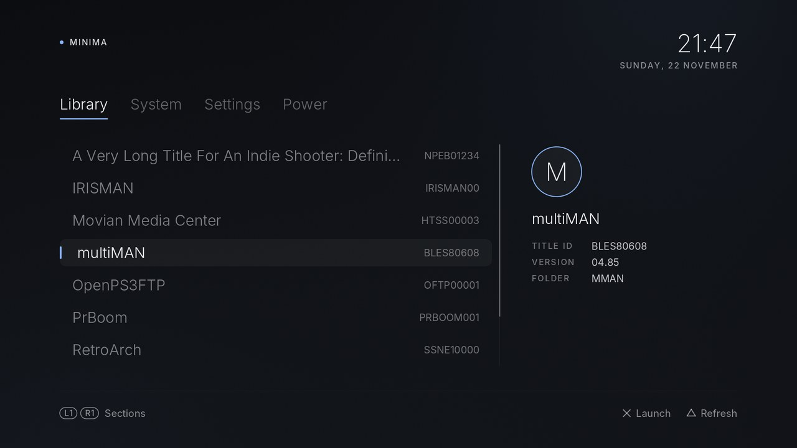
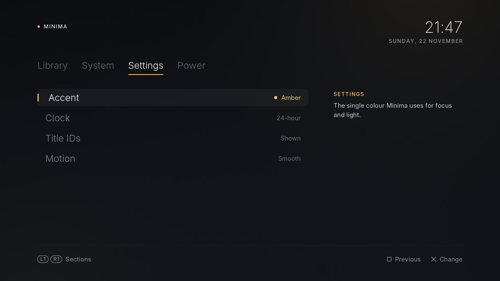
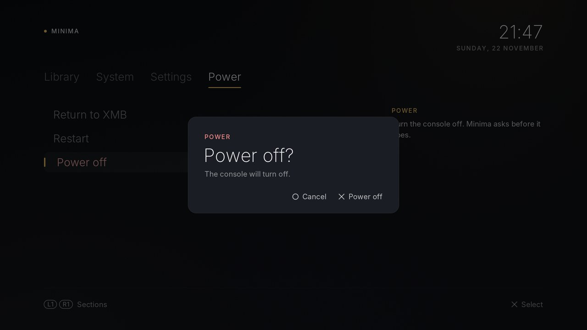

# Minima — минималистичная оболочка для PS3

Тихий домашний экран для PlayStation 3: тёмный фон с мягким свечением, шрифт Inter, один акцентный цвет, плавные анимации и ничего лишнего. Это homebrew-приложение (собирается открытым SDK PSL1GHT), а не замена системного ПО: оно запускается из XMB и в любой момент возвращает в него, поэтому консоль им не «окирпичить».



| Настройки | Питание |
|---|---|
|  |  |

## Что умеет

- **Library** — все приложения из `/dev_hdd0/game` (категория `HG` с `USRDIR/EBOOT.BIN`), по алфавиту, с названием, Title ID, версией и папкой. Запуск по ✕, пересканирование по △.
- **System** — консоль, разрешение экрана, свободное место на HDD, число приложений, время сессии.
- **Settings** — акцентный цвет (Ice, Mint, Amber, Rose, Lilac, Mono), 24/12-часовые часы, показ Title ID, плавная или упрощённая анимация. Сохраняется в `USRDIR/minima.cfg`.
- **Power** — вернуться в XMB, перезагрузить, выключить (с подтверждением).
- Часы с часовым поясом консоли, кириллица в названиях, работа с левым стиком, 720p и 1080p.

## Управление

| Кнопка | Действие |
|---|---|
| ← → или L1 / R1 | разделы |
| ↑ ↓ (зажать — быстрая прокрутка) | выбор |
| ✕ | запустить / изменить / выбрать |
| □ | предыдущее значение настройки |
| △ | обновить библиотеку |
| ○ | отмена в диалоге |
| START | раздел Power |

Если в консоли подтверждение назначено на ○ (японские консоли), кнопки и подсказки меняются местами автоматически, когда SDK это поддерживает.

## Установка

Нужна PS3 с CFW или PS3HEN — неподписанные приложения на заводской прошивке не запускаются.

1. Скачайте `minima.pkg` из артефактов GitHub Actions (workflow **PS3 Minima**) или соберите сами.
2. Скопируйте на флешку (FAT32) в корень, вставьте в правый USB-порт.
3. XMB → Game → Package Manager → Install Package Files → Minima.
4. Запуск — иконка Minima в разделе Game.

Запуск коммерческих игр через `EBOOT.BIN` зависит от лицензий и прошивки; для homebrew работает напрямую. Перезагрузка и выключение используют системный вызов lv2 379 и требуют CFW/HEN.

## Сборка

С Docker:

```bash
docker run --rm -v "$PWD:/src" -w /src flipacholas/ps3devextra make pkg
```

Или с установленными ps3toolchain и PSL1GHT (`$PS3DEV`, `$PSL1GHT`): `make` даёт `minima.self` (для `ps3load`), `make pkg` — `minima.pkg`.

### Просмотр на компьютере

Интерфейс не зависит от консоли: `sim/` подменяет платформенный слой и рисует кадры в файлы.

```bash
cd sim
python3 make_mock.py mock/game      # тестовая библиотека с настоящими PARAM.SFO
make
./minima-sim -r 1920x1080 -g mock/game 'w90,shot,R,w30,shot'
```

Скрипт — шаги через запятую: `U D L R X O T S L1 R1 ST` нажимают кнопку, `wN` ждёт N кадров, `shot` сохраняет кадр в `shotNN.ppm`.

## Устройство

| Файл | Что внутри |
|---|---|
| `source/main.c` | интерфейс: разделы, список, панель деталей, диалоги, анимации |
| `source/gfx.c` | программный рендер: сглаженные фигуры через SDF, альфа-смешение, текст |
| `source/font.c` | атлас шрифта, UTF-8 |
| `source/library.c` | разбор `PARAM.SFO` и сканирование приложений |
| `source/platform_ps3.c` | PSL1GHT: RSX-буферы, геймпады, файлы, запуск, питание |
| `sim/` | десктопная реализация платформы для превью и проверок |
| `tools/make_font.py` | растеризует Inter в `data/font.bin` (1.0× и 1.5×) |
| `tools/make_icon.py` | рисует `ICON0.PNG` для XMB |

Кадр рисуется в основной памяти и копируется в буфер RSX (читать видеопамять с PPU очень медленно), а когда ничего не движется, перерисовка останавливается совсем.

Шрифт Inter распространяется по SIL Open Font License 1.1 (`data/LICENSE-Inter.txt`).
