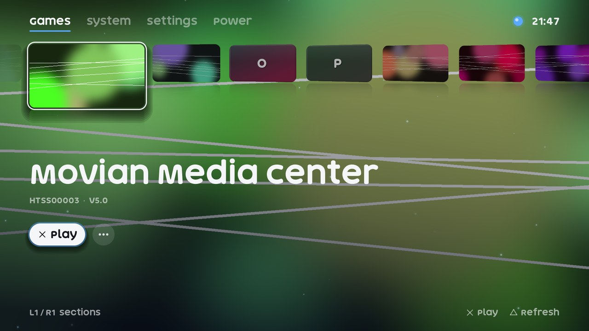
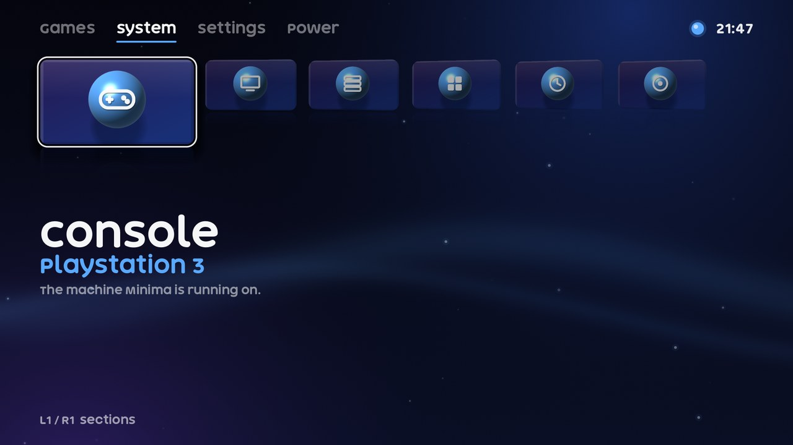
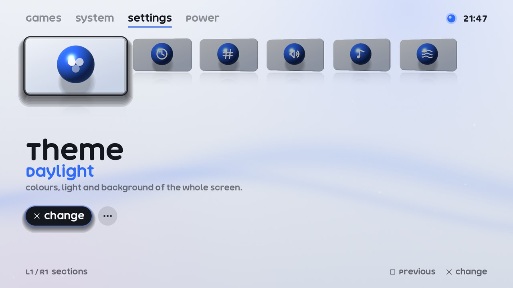

# Minima — домашний экран для PS3 в духе современных консолей

Homebrew-оболочка для PlayStation 3: ряд карточек с обложками игр, полноэкранный арт выбранной игры, объёмные значки, 3D-наклон и отражения карточек, частицы, анимации и звуки на каждое действие, шесть тем. Собирается открытым SDK PSL1GHT и запускается из XMB, системное ПО не меняет.



| Система | Тема Daylight | Питание |
|---|---|---|
|  |  |  |

*Обложки на скриншотах — абстрактные заглушки из `sim/make_mock.py`. На консоли показываются настоящие `ICON0.PNG` и `PIC1.PNG` игр.*

## Что внутри

- **Games** — приложения из `/dev_hdd0/game` карточками с их `ICON0.PNG`. Выбранная карточка крупнее, с белой рамкой, тенью, бликом и лёгким «дыханием». Соседние карточки повёрнуты в перспективе и отражаются в «полу». Фон — `PIC1.PNG` игры с параллаксом и плавной сменой. У игр без обложки — сгенерированная карточка с буквой.
- **Запуск** — карточка разворачивается на весь экран под звук, затем стартует `EBOOT.BIN`.
- **System, Settings, Power** — объёмные значки: глянцевая сфера с освещением, тиснёный символ, скошенная панель.
- **Темы**: Cosmic, Aurora, Sunset, Sakura, Graphite и светлая Daylight. Меняют фон, свечение, ленты света, частицы, значки и акцентный цвет.
- **Звуки** синтезируются кодом при старте: перемещение, упор в край, разделы, подтверждение, отмена, переключатели, уведомления, запуск, ошибка, стартовый аккорд и тихая фоновая музыка. Эффекты и музыка отключаются в настройках.
- **Шрифт** AA Logotyper Rounded. Символов, которых в нём нет, берутся из Inter.
- Настройки: тема, 24/12-часовые часы, Title ID, звуки, фоновая музыка, анимация (Smooth/Reduced). Сохраняются в `USRDIR/minima.cfg`.

## Управление

| Кнопка | Действие |
|---|---|
| ← → | карточки (у края — пружинящий отскок) |
| ↑ ↓ или L1 / R1 | разделы |
| ✕ | играть / изменить / выбрать |
| □ | предыдущее значение настройки |
| △ | пересканировать игры |
| ○ | отмена в диалоге |
| START | раздел Power |

## Установка

Нужна PS3 с CFW или PS3HEN.

1. Возьмите `minima.pkg` из артефактов GitHub Actions (workflow **PS3 Minima**) или соберите сами.
2. Положите его в корень флешки (FAT32) и вставьте её в консоль.
3. XMB → Game → Package Manager → Install Package Files → Minima.

Коммерческие игры через `EBOOT.BIN` запускаются не всегда — это зависит от лицензий и прошивки. Homebrew запускается напрямую. Перезагрузка и выключение используют системный вызов lv2 379.

## Сборка

```bash
docker run --rm -v "$PWD:/src" -w /src flipacholas/ps3devextra make pkg
```

С установленными ps3toolchain и PSL1GHT: `make` собирает `minima.self`, `make pkg` — `minima.pkg`.

### Просмотр на компьютере

```bash
cd sim
python3 make_mock.py mock/game      # тестовая библиотека: PARAM.SFO, ICON0, PIC1
make                                # нужен libpng
./minima-sim -r 1920x1080 -g mock/game 'w90,shot,R,w30,shot'
```

Шаги скрипта: `U D L R X O T S L1 R1 ST` нажимают кнопку, `wN` ждёт N кадров, `shot` пишет кадр в `shotNN.ppm`.

## Устройство

| Файл | Что внутри |
|---|---|
| `source/main.c` | интерфейс, темы, генерация 3D-значков, анимации |
| `source/gfx.c` | программный рендер: SDF-фигуры, перспективные карточки, отражения, тени, текст |
| `source/sound.c` | синтезатор и микшер звуков |
| `source/library.c` | `PARAM.SFO`, обложки, сканирование приложений |
| `source/platform_ps3.c` | PSL1GHT: видео, геймпады, PNG (pngdec), аудиопоток, запуск, питание |
| `sim/` | десктопная платформа для превью |
| `tools/make_font.py` | растеризует шрифт в `data/font.bin` |

Всё рисуется процессором в основной памяти и копируется в буфер RSX. На ПК кадр занимает около 6 мс в 720p и 12 мс в 1080p. PPU у PS3 медленнее, так что в 1080p частота кадров может проседать. Если так будет, следующий шаг — перенести карточки и фон на видеочип RSX. В режиме Motion: Reduced эффекты выключаются и нагрузка падает.

## Лицензии

- AA Logotyper Rounded — Vasily Shishkin, бесплатен для личного и коммерческого использования (`fonts/LICENSE-Logotyper.txt`).
- Inter — SIL Open Font License 1.1 (`data/LICENSE-Inter.txt`).
